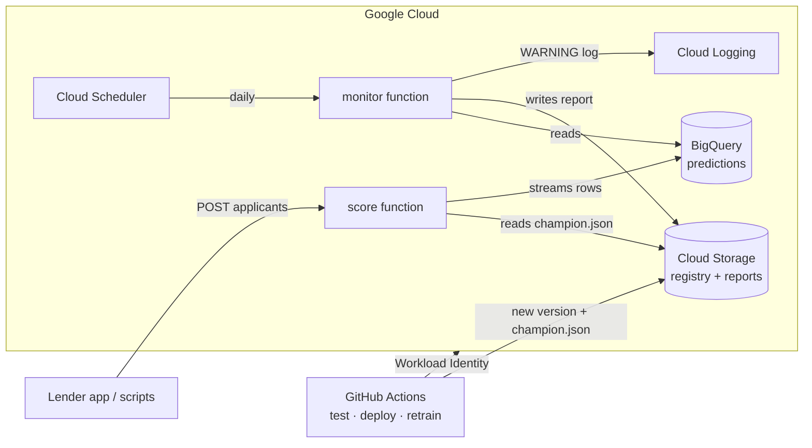

# Credit Risk Scorecard on Google Cloud

A loan-default model for personal-loan applications, served from **Cloud Run functions** and run like a real lending model: versioned, gated before release, explained to applicants, watched for drift, retrained after an economic shock, and easy to roll back.

For each applicant it returns a **probability of default**, a **300–850 score**, a decision (**approve / review / decline**) and, when not approved, the **top reasons**, the way lenders have to explain adverse decisions. All data is synthetic.

## What runs where

| Piece | Google Cloud service | What it does |
|---|---|---|
| `score` function | Cloud Run functions (HTTP, private) | Scores applicants with the current champion model |
| `monitor` function | Cloud Run functions (HTTP, private) | Compares recent traffic with training data, writes a drift report |
| Model registry | Cloud Storage `gs://BUCKET/registry` | Every model version, its metrics, model card, and `champion.json` |
| Prediction log | BigQuery `credit_risk.predictions` | Every scored application, partitioned by day |
| Daily monitoring | Cloud Scheduler | Calls `monitor` every morning with a signed identity token |
| Alerts | Cloud Logging | `monitor` writes a WARNING entry when drift is found |
| CI/CD | GitHub Actions + Workload Identity Federation | Tests, deploys functions, retrains on demand. No key files |



**Releasing a model never redeploys anything.** Training writes a new version folder. The promotion gate rewrites `champion.json`, and the running `score` function re-reads it at most every 60 seconds. Rolling back is the same small write.

## The model and the rules it must pass

The model is a logistic-regression scorecard on engineered features: income (log), loan-to-income, debt-to-income, utilisation, delinquencies, inquiries, credit history, employment, term, housing and purpose. **Age is never an input**; it's used only to check fairness.

A new version only reaches production if it passes every check in `promote.py`. The thresholds live in `src/credit_risk/config.py`.

| Check | Rule | Why lenders care |
|---|---|---|
| Ranking | AUC ≥ 0.72 and KS ≥ 0.30 on a fixed holdout | Must separate good and bad borrowers |
| Calibration | Mean predicted PD within 2 points of the observed default rate | Prices and loss reserves are based on PD |
| Fairness | Approval rate of under-30 and 62+ applicants ≥ 80% of ages 30–61 (four-fifths rule) | Disparate-impact risk |
| Business logic | Risk must go **up** with DTI, utilisation, delinquencies and inquiries, and **down** with income, history and employment | Model-risk sanity check |
| Better than champion | Brier score at least 0.0005 lower on the same evaluation set | Don't churn production for noise |

**After an economic shock** the comparison changes. A model retrained with post-shock data (`--regime downturn`) is compared with the champion on **recent, out-of-time applications** rather than the old holdout, with the champion re-scored on exactly the same applications. Ranking, fairness and business logic are still checked on the through-the-cycle holdout. In testing:

| On recent post-shock applications | Champion (pre-shock) | Retrained |
|---|---|---|
| Calibration gap (predicted vs actual default rate) | 5.1 pts, **too optimistic** | 1.7 pts |
| Brier score | 0.172 | 0.169 |

So the retrained model is promoted. A model trained on post-shock data *only* is rejected, because its approval rate for under-30 applicants falls below the four-fifths line.

---

## Step-by-step

### Before you start

- A Google Cloud project **with billing enabled**, and the `gcloud` CLI installed (`gcloud --version`).
- **Python 3.12.** The model libraries are pinned to versions that match the Cloud Run `python312` runtime. On a Mac: `brew install python@3.12`.
- Git, and optionally the GitHub CLI `gh`.
- **Set a budget alert** first (Billing → Budgets & alerts → $5). This project costs pennies when idle (functions scale to zero), but a budget is good practice.

### Step 1: Put the code on GitHub

```bash
unzip credit-risk-gcp.zip && cd credit-risk-gcp
git init
git branch -M main
git add .
git commit -m "Credit risk scorecard on Cloud Run functions"
```

With the GitHub CLI:

```bash
gh auth login
gh repo create credit-risk-gcp --public --source=. --remote=origin --push
```

Without it, create an empty repo at https://github.com/new (no README, .gitignore or license), then:

```bash
git remote add origin https://github.com/<you>/credit-risk-gcp.git
git push -u origin main
```

The **CI** workflow runs immediately and should go green. **Deploy functions** runs its tests and skips the deploy job until Google Cloud is set up (Step 5).

### Step 2: Run it locally first

```bash
python3.12 -m venv .venv
source .venv/bin/activate
pip install -r requirements-dev.txt
pip install --no-deps -e .
pytest                  # 49 tests, no cloud needed
make train && make promote
```

`make train` generates the data and trains v1 into `local_registry/`; `make promote` runs the gate and makes v1 the champion.

To try the real function code on your machine, start it in one terminal:

```bash
make serve-local        # http://localhost:8080
```

Then send traffic from another:

```bash
source .venv/bin/activate
make traffic-local
```

### Step 3: Log in to Google Cloud

```bash
gcloud auth login
gcloud auth application-default login       # lets Python on your laptop use your account
cp infra/config.env.example infra/config.env
```

Edit `infra/config.env`:

```
PROJECT_ID=<your project id>          # gcloud projects list
REGION=us-east1
GITHUB_REPO=<your-github-user>/credit-risk-gcp
```

Then point the application-default credentials at your project:

```bash
gcloud auth application-default set-quota-project <your project id>
```

### Step 4: One-time cloud setup

```bash
make gcp-setup
```

This runs `infra/setup.sh`, which is safe to run again. It:

1. enables the APIs (Cloud Run functions, Cloud Build, Artifact Registry, Storage, BigQuery, Scheduler, IAM…);
2. creates the bucket `gs://<project>-credit-risk`, with object versioning so every `champion.json` change is recoverable;
3. creates the BigQuery dataset `credit_risk` and the day-partitioned table `predictions`;
4. creates three service accounts with least privilege: `credit-risk-fn` (runtime), `credit-risk-deployer` (GitHub Actions) and `credit-risk-scheduler` (calls `monitor`);
5. grants the default compute account the Cloud Build role new projects need to build functions;
6. sets up **Workload Identity Federation**, so only *your* GitHub repo can deploy, and no key file is ever created;
7. prints the values GitHub needs.

### Step 5: Give GitHub those values

Copy the `gh variable set …` lines that `setup.sh` printed and run them in the repo folder. Or add them by hand under **Settings → Secrets and variables → Actions → Variables**:

`GCP_PROJECT_ID`, `GCP_PROJECT_NUMBER`, `GCP_REGION`, `GCS_BUCKET`, `WIF_PROVIDER`, `DEPLOYER_SA`

None of these are secrets. Security comes from the Workload Identity condition, which only trusts tokens from your repository.

### Step 6: Train and promote the first model into Cloud Storage

```bash
make train-cloud
make promote-cloud
make champion           # {"version": "v1", ...}
```

In the console, go to **Cloud Storage → your bucket → registry/versions/v1/** to see `model.joblib`, `metrics.json`, `reference_profile.json` and `model_card.md`.

### Step 7: Deploy the functions

```bash
make deploy
```

The first deploy takes 3–5 minutes per function while Cloud Build creates the images. It prints both URLs. Both functions are **private**: callers need an identity token. From now on, every push to `main` that touches `src/` or `function/` redeploys automatically through `.github/workflows/deploy.yml`. To check the GitHub side works too, go to **Actions → Deploy functions → Run workflow**.

### Step 8: Call it

```bash
make smoke
```

This prints `{"status": "ok", "model_version": "v1"}`, then a scored applicant with PD, score, decision and reasons. Next, send a realistic batch:

```bash
make traffic            # 500 applications, about half approved
```

Look at the data in **BigQuery → credit_risk → predictions → Query**:

```sql
SELECT model_version, decision, COUNT(*) AS n, ROUND(AVG(pd), 3) AS avg_pd, ROUND(AVG(score)) AS avg_score
FROM `credit_risk.predictions`
WHERE ts > TIMESTAMP_SUB(CURRENT_TIMESTAMP(), INTERVAL 1 DAY)
GROUP BY 1, 2 ORDER BY 1, 2;
```

```sql
-- which reasons drive declines?
SELECT reason, COUNT(*) AS n
FROM `credit_risk.predictions`, UNNEST(reasons) AS reason
WHERE decision = 'decline'
GROUP BY reason ORDER BY n DESC;
```

### Step 9: Schedule monitoring

```bash
make schedule           # daily at 08:00 New York time
make monitor-now        # run it now and print the report
```

After normal traffic, every check is 🟢: score PSI, PSI for income, DTI, utilisation, inquiries, loan amount and credit history, and approval-rate shift. Reports are kept in `gs://BUCKET/reports/monitoring/`.

### Step 10: Simulate an economic downturn

```bash
make traffic-downturn
make monitor-now
```

Now the report goes 🔴. Score PSI is about 1.0, DTI, utilisation and inquiry PSIs are well past 0.25, and the approval rate falls about 35 points. The `monitor` function also writes a **WARNING** log entry. To see it, open **Logging → Logs Explorer** and run:

```
jsonPayload.message="credit-risk monitoring"
severity=WARNING
```

Optionally, get an email when it happens: in Logs Explorer, choose **Actions → Create log alert**, use that query, and choose an email notification channel.

### Step 11: Retrain after the shock, from GitHub Actions

On GitHub, go to **Actions → Retrain and gate → Run workflow**, choose **regime: downturn**, and click **Run workflow**.

The job trains v2 with post-shock applications added and runs the gate on recent applications. Then:

- If it passes, the job rewrites `champion.json`. Within about a minute, `make smoke` shows `"model_version": "v2"` with no redeploy.
- The run's summary page shows the promotion table and the model card.

The same thing from your laptop is `make retrain-downturn`.

Try a **rejection** too: run the workflow with **regime: normal**. Same data means no improvement, so the gate keeps the champion and says why.

### Step 12: Roll back

```bash
make rollback-cloud
make champion           # back to the previous version
```

Every champion change, including rollbacks, is appended to `registry/history.json`.

### Step 13: Change code through a pull request

```bash
git checkout -b tweak-policy
# e.g. change APPROVE_BELOW_PD in src/credit_risk/config.py
git commit -am "Tighten approval cutoff"
git push -u origin tweak-policy
gh pr create --fill
```

CI tests the change on the pull request. Merging it to `main` triggers **Deploy functions**, which re-runs the tests, deploys both functions and checks that they're ACTIVE.

### Step 14: Clean up when you're done

```bash
make teardown
```

This deletes the functions, the scheduler job, the bucket and the dataset.

---

## Evidence to capture for submission

Save these as screenshots in `docs/`:

1. Cloud Storage: `registry/versions/` with several versions and `champion.json`.
2. Cloud Run functions list: `score` and `monitor` ACTIVE.
3. `make smoke` output: a decline with its reason codes.
4. BigQuery: the two queries above.
5. Cloud Scheduler: the `credit-risk-monitor` job and its last run.
6. Monitoring reports before and after the downturn (`make report`).
7. Logs Explorer: the WARNING entry from `monitor`.
8. GitHub Actions: a Retrain run approving v2 (summary page) and one rejecting.
9. GitHub Actions: CI and Deploy green.

## Troubleshooting

| Error | Fix |
|---|---|
| `Build failed ... missing permission` on first deploy | Re-run `make gcp-setup` (it grants the Cloud Build role to the default compute account), wait 2 minutes, deploy again |
| `PERMISSION_DENIED ... iam.serviceAccounts.actAs` in the Deploy workflow | `setup.sh` grants this. Re-run it if you created the project after a failed run, then re-run the workflow |
| `google-github-actions/auth` fails with *unauthorized_client* or *attribute condition* | `GITHUB_REPO` in `infra/config.env` must match the repo exactly (owner/name, case-sensitive). Fix it and run `make gcp-setup` again |
| `403 Forbidden` from `make smoke` | You need an identity token, and your user needs invoker rights (project owners have them). Run `gcloud auth login` again |
| `DefaultCredentialsError` when running `make train-cloud` | Run `gcloud auth application-default login` |
| `503 No champion model yet` | Run `make train-cloud && make promote-cloud`, then wait up to 60 s |
| `pip` fails installing `numpy==2.1.3` | Use Python 3.12 (`python3.12 -m venv .venv`) |
| Scheduler job fails with 403 | Run `make schedule` again; it grants the scheduler account invoker rights on `monitor` |

## Project layout

```
credit-risk-gcp/
├── src/credit_risk/
│   ├── config.py        thresholds, policy, schema, cloud settings
│   ├── data.py          synthetic applicants (normal / downturn) + data contract + fingerprints
│   ├── model.py         features, scorecard, KS, fairness, 300-850 scaling, reason codes
│   ├── train.py         train + register a version (local folder or gs://)
│   ├── promote.py       promotion gate, champion pointer, rollback
│   ├── registry.py      versioned registry on top of storage
│   ├── storage.py       one interface: local folder or Cloud Storage
│   ├── sinks.py         prediction log: JSONL locally, BigQuery in the cloud
│   ├── monitoring.py    PSI and approval-rate drift checks
│   └── service.py       request handling, model cache with hot reload, monitor job
├── function/            Cloud Run functions entry points + pinned runtime requirements
├── infra/               setup, deploy, schedule and teardown scripts, BigQuery schema
├── scripts/             traffic generator, sample applicant
├── tests/               49 tests, with in-memory Cloud Storage / BigQuery fakes
└── .github/workflows/   ci.yml, deploy.yml, retrain.yml
```

## Design notes and limitations

- **Training and serving use exactly the same library versions** (CI checks the pins match), because a pickled scikit-learn model should be loaded by the version that saved it. The function also logs a warning if they ever differ.
- **A failed prediction log never blocks a credit decision,** but it's logged as an ERROR so you'll notice.
- **If Cloud Storage is unreachable, the function keeps serving the model it already has.**
- **Real default labels arrive months later.** This project monitors inputs and decisions (PSI, approval rate), which is what lenders watch day to day. Back-testing against actual defaults would be a scheduled BigQuery job once outcomes arrive.
- **Fairness here is the four-fifths rule on age groups only.** Real lenders also test other protected groups, usually through proxy methods, plus "less discriminatory alternative" searches.
